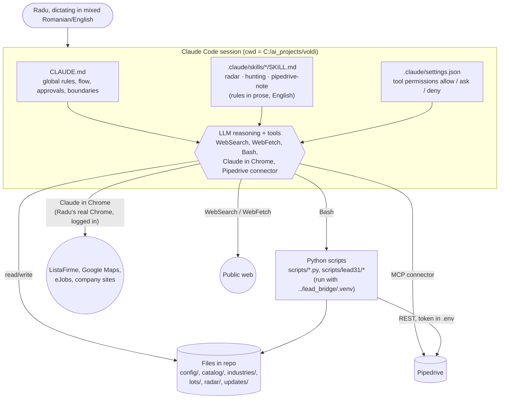
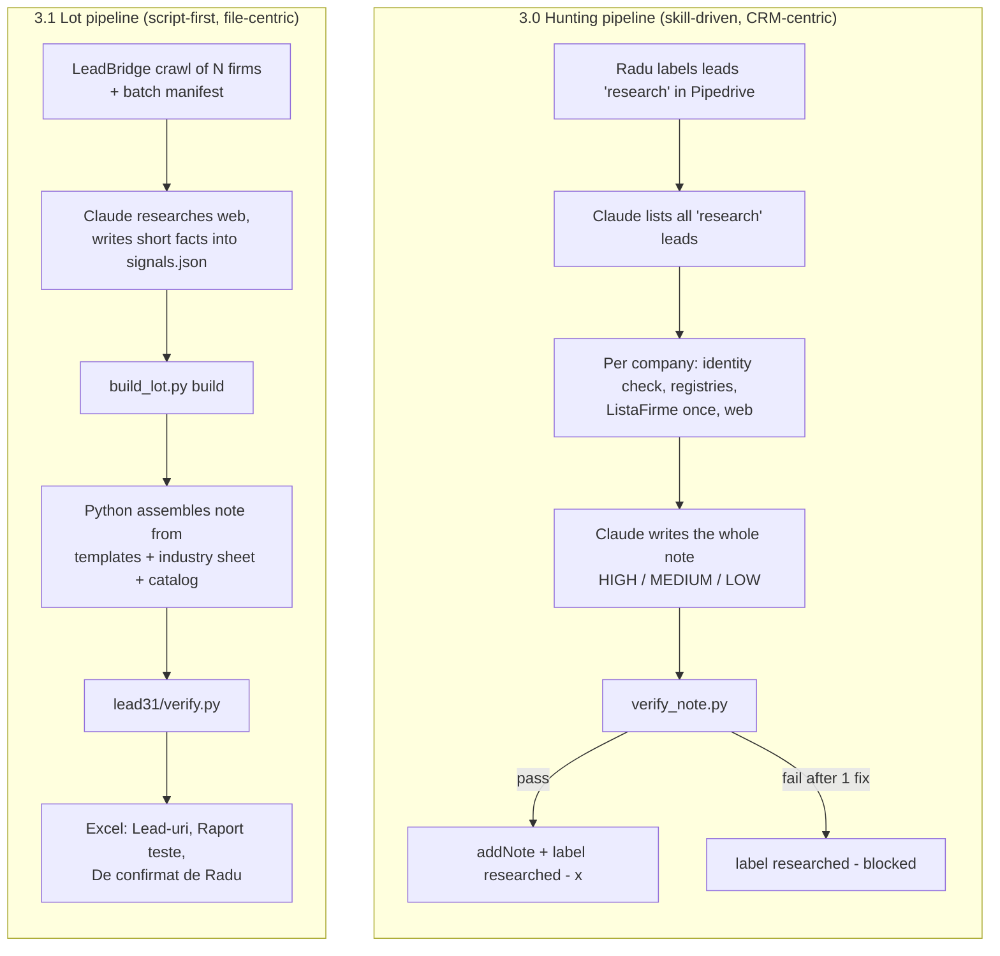

# 02. Architecture

## 2.1 Runtime model

Voldi has **no server, no daemon and no database**. A "run" is an interactive Claude Code session started by Radu in `C:\ai_projects\voldi` on his Windows laptop (never the Vodafone laptop). Behaviour comes from four layers:



Key consequences:
- The **model is the orchestrator**. Python never calls the model; the model calls Python (via Bash) when a skill or plan tells it to.
- **State lives in external systems and files**: Pipedrive labels (which leads are done), `signals.json` (what was researched), radar files (what was already reported), plan "Status" sections (what was built).
- Browser access goes through **Radu's own Chrome** (extension "Claude in Chrome"), so his ListaFirme login is reused, with the risk that over-use logs him out.

## 2.2 External systems

| System | Used by | How | Constraints |
|---|---|---|---|
| ListaFirme | hunting (live), lot pipeline (saved HTML) | Hunting: one Chrome visit per company. Lot: parses HTML saved by LeadBridge in `lead_bridge/data/listafirme_pages/`. `scripts/fetch_listafirme_page.py` can also open a page through LeadBridge's Playwright profile (manual confirmation step). | Session logs out on repeated navigation; stop the whole run if logged out. Financial tables must be read in EUR. |
| LeadBridge | lot pipeline | Imports `leadbridge.html_extractor` (`extract_company_page`, `extract_cifre`) from `../lead_bridge/src`; reads workbook `../lead_bridge/data/leadbridge_workbook.xlsx` sheet `Prospectare SMB`; reads crawl manifests. Shares its Python venv. | Voldi must never modify it. |
| Pipedrive | hunting, pipedrive-note, scripts | MCP connector (`mcp__claude_ai_Pipedrive__*`) for skills; REST v1 with `PIPEDRIVE_API_TOKEN` from `.env` for scripts. | Add-only. Connector has no label filter; lead pages are ~75k characters. |
| Public web | radar, hunting, lot research | WebSearch, WebFetch, Chrome. Sources: company site, Google Maps, eJobs, BestJobs, LinkedIn Jobs, undelucram.ro, Glassdoor, SEAP/SICAP, Monitorul Oficial, ANAF, ministries, AFIR, business press. | eJobs behind Cloudflare (needs 4 to 8 s pauses); WebSearch cannot open eJobs; LinkedIn/Facebook need login (not bypassed). |

## 2.3 Components

| Component | Type | Input | Output | Doc |
|---|---|---|---|---|
| `radar` | Skill (prompt only) | Web | `radar/radar-YYYY-MM-DD[-n].md` (auto-saved) | [03](03-radar.md) |
| `hunting` | Skill + `verify_note.py` | Pipedrive leads with label `research`, web, ListaFirme, newest radar file | Pipedrive note + label swap, or note in chat | [04](04-hunting.md) |
| `pipedrive-note` | Skill | One named lead/deal + note text | One Pipedrive note after explicit "da" | [08](08-pipedrive.md) |
| `build_lot.py` + `lead31/` | Python CLI | LeadBridge manifest, saved HTML, LeadBridge workbook, `signals.json`, industry sheet, catalog, lot config | `lots/<industry>_<date>.xlsx` (3 sheets) | [05](05-lot-pipeline.md) |
| `verify_note.py` | Python CLI | One hunting note (file or stdin) + blocklist | Exit code + list of violations | [07](07-verification-and-tests.md) |
| `lead31/verify.py` | Python module | `Note`, `Signals`, catalog | List of problems | [07](07-verification-and-tests.md) |
| `pipedrive_client/read/write.py`, `refresh_field_map.py` | Python CLI | `.env` token | JSON to stdout, new note, field map table | [08](08-pipedrive.md) |
| `fetch_listafirme_page.py` | Python CLI | URL | Page text (via LeadBridge Playwright profile) | this page |
| Dossier | Spec only (`updates/voldi-3.0.md` §7) | Hunting note, call feedback, radar, catalog | Meeting prep note | [04](04-hunting.md#dossier-phase-2-specified-not-built) |

## 2.4 The two pipelines



| Aspect | 3.0 Hunting | 3.1 Lot pipeline |
|---|---|---|
| Unit of work | Pipedrive lead | CUI in a LeadBridge manifest |
| Who writes the sentences | Claude (whole note) | Python templates; Claude only writes short facts |
| Note format | `[VOLDI-RESEARCH] Hunting \| …` with `━━ SECTION ━━` blocks | Blocks 0 to 5 (who / firm / reviews / jobs / where it loses / solutions + questions) |
| Solutions in the note | **Forbidden** (blocklist enforces it) | **Required** block 5 (catalog card + status) |
| Priority | HIGH / MEDIUM / LOW | None (Excel order: primary, rest, group subsidiaries, duplicates) |
| Verifier | `scripts/verify_note.py` (regex, ~50 rules) | `scripts/lead31/verify.py` |
| Output | Pipedrive note + label | Excel file, no Pipedrive |
| Declared status in CLAUDE.md | Active | Not mentioned |

## 2.5 Folder map (13.10.2026)

```
voldi/
├── CLAUDE.md                     # global rules (declares updates/voldi-3.0.md active)
├── README.md                     # Romanian setup notes (partly stale)
├── requirements.txt              # requests==2.32.3 (openpyxl, playwright come from LeadBridge venv)
├── .env                          # PIPEDRIVE_API_TOKEN=... (git-ignored)
├── .gitignore                    # .env, __pycache__/, *.pyc
├── .claude/
│   ├── settings.json             # permissions + caveman user-invocable-only
│   └── skills/
│       ├── radar/SKILL.md        # ~6.8 KB
│       ├── hunting/SKILL.md      # ~23 KB
│       └── pipedrive-note/SKILL.md
├── config/
│   ├── hunting-mode.md           # write_mode: on
│   ├── pipedrive-field-map.md    # custom field hash keys + lead label IDs
│   └── product-blocklist.md      # banned words for hunting notes
├── catalog/
│   ├── nonstandard-solutions.md  # S01–S106 solution cards
│   ├── standard-solutions.md     # empty (title only)
│   ├── subscription-tech.md      # "Tehnologie pe Abonament" categories
│   └── archive/                  # retired problem catalog (never read)
├── industries/
│   └── distributie-angro.json    # industry sheet, CAEN 46
├── lots/
│   ├── distributie-angro/        # lot50.json, lot70.json, signals.json, config.json,
│   │                             # _recheck.json, lot51_cuis.txt, add_signals.py, add_site*.py
│   └── distributie-angro_2026-10-12.xlsx
├── radar/                        # radar-2026-10-06.md, -06-2, -12, -12-2, -12-3
├── scripts/
│   ├── build_lot.py              # 3.1 CLI: prepare | build
│   ├── lead31/                   # profile, note, verify, group, catalog
│   ├── verify_note.py            # 3.0 hunting verifier
│   ├── pipedrive_client.py, pipedrive_read.py, pipedrive_write.py, refresh_field_map.py
│   └── fetch_listafirme_page.py
├── tests/                        # unittest: 121 test methods across 5 files
├── updates/                      # plans 2.1–2.5, 3.0, 3.1 (+HANDOFF), 3.2, HANDOVER.md
└── docs/                         # this documentation + docs/superpowers (old specs)
```

Sibling dependency (outside the repo): `C:\ai_projects\lead_bridge\` with `src/leadbridge/`, `.venv/`, `data/leadbridge_workbook.xlsx`, `data/listafirme_pages/`, `data/batches/`, `data/playwright_profile/`.

## 2.6 Where the "rules" actually live

There is no single spec. Behaviour is the union of:

1. `CLAUDE.md` (loaded every session),
2. the three `SKILL.md` files (loaded when a skill triggers),
3. `config/*.md` (read by skills and scripts at run time),
4. constants and regexes inside `scripts/verify_note.py` and `scripts/lead31/*.py`,
5. the industry sheet JSON and the lot `config.json`,
6. decisions recorded only in the "Status" sections of plans in `updates/` (for example the priority rules in `voldi-3.0.md` Status were later copied into the hunting skill; some 3.1 decisions exist only in `voldi-3.1-HANDOFF.md`).

CLAUDE.md says plans are "history, not active context", but in practice the newest plans (3.1, 3.1-HANDOFF, 3.2) are the only description of the lot pipeline.
