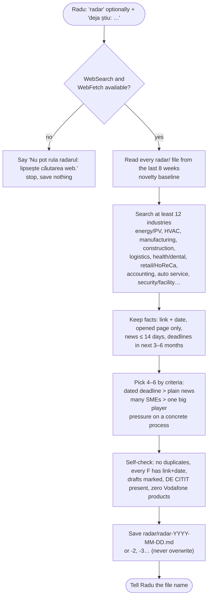

# 03. Radar (Phase 0)

Skill: `.claude/skills/radar/SKILL.md`. Triggered when Radu says "radar".

**Question it answers:** which industries have a real, current, external reason (law, deadline, funding call, scandal, investment, hiring wave) that makes small firms worth calling now? Industries are the **output**, not the input.

## Flow



## Rules (as implemented in the skill)

1. Fact types: laws, deadlines, news, scandals, funding calls, investments/new projects, hiring waves, INS/BNR/industry trends. Each `[F]` has a link and a date.
2. Window: news from the last 7 to 14 days; deadlines in the next 3 to 6 months.
3. Source order: primary (Monitorul Oficial, ANAF, ministries, ANRE, AFIR, PNRR guides, consultations) → business press (Ziarul Financiar, Profit.ro, Wall-Street.ro, Economica.net) → industry press.
4. Selection without a score: dated deadline beats news; facts hitting many SMEs beat facts about one player; the fact must pressure a concrete process (reporting, fleet, stock, staff, payments).
5. **Zero Vodafone products or solutions** anywhere.
6. `NONE FOUND` is valid. Never pad to reach 4.
7. Romanian output, no caveman.
8. Blocked source = "blocat"; never bypass login/paywall; snippet-only facts are not used.
9. Public sources only; unconfirmable date = fact not used.
10. "Problemă probabilă" `[I]` describes the pressure created by the fact, never how firms work today unless sourced.
11. Drafts marked "(proiect, neadoptat)"; "De ce acum" relies only on adopted facts.
12. Segment named in the heading when the fact hits only a segment.
13. `DE CITIT:` line with the official act link (legislatie.just.ro, MO, institution site) plus one press article. Never a press link in place of the act.
14. Self-check before saving.
15. Novelty: an industry/fact already in the last 8 weeks is skipped unless there is a new development ("ACTUALIZARE:").
16. Size filter: prefer facts that reach 1 to 49 employee firms.
17. At least 12 industries searched; return 4 to 6.

## Output format

```
[VOLDI-RADAR] YYYY-MM-DD

1. {INDUSTRIE} / {INDUSTRIE — SEGMENT}
   Fapt: {…}, {dată} — {link} [F]  ({„(proiect, neadoptat)”})
   Problemă probabilă: {presiunea creată} [I]
   De ce acum: {doar fapte adoptate}
   CINE SUNĂ (1–49 ang.): {tipuri de firme mici} [I]
   DE CITIT: {act oficial — nr., dată} — {link oficial} | {articol presă — link}

NONE FOUND: … (doar dacă sunt sub 4 industrii)
```

Real example (radar-2026-10-12-2.md, abridged): TollRo distance-based toll for >3.5 t vehicles from 01.10.2026; AFIR DR-14 / DR-12 funding sessions closing 31.10 / 02.12.2026; annual food-waste reporting obligation (Law 217/2016, deadline 31.03.2027); new construction code Law 169/2026 in force from 25.08.2026.

## How radar feeds the rest

- **Hunting** reads the **newest** radar file only if it is at most 14 days old (by file name date) and may add one `CONTEXT INDUSTRIE:` line. Radar context **never** raises priority, never becomes the TRIGGER, never becomes the HOOK.
- **Radu** uses it to choose which CAEN filters to set in ListaFirme for the next LeadBridge crawl.
- **Dossier** (not built) would use it for Opportunities/Threats.
- The lot pipeline (3.1) does not read radar files.

## Storage

Plain markdown, append-only, one file per run. Existing files on 13.10.2026: `radar-2026-10-06.md`, `radar-2026-10-06-2.md`, `radar-2026-10-12.md`, `radar-2026-10-12-2.md`, `radar-2026-10-12-3.md`. This is the only write CLAUDE.md allows without a DA.
