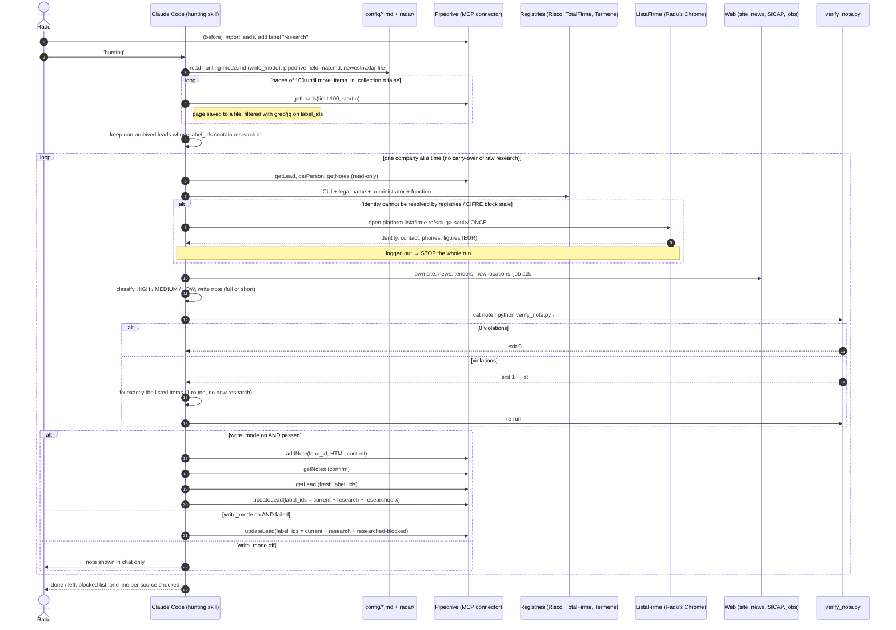
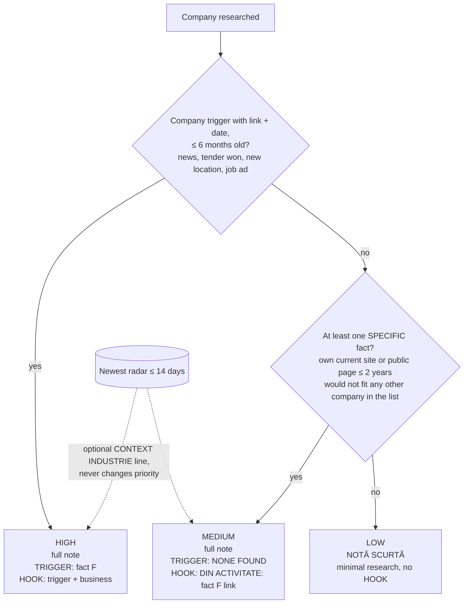
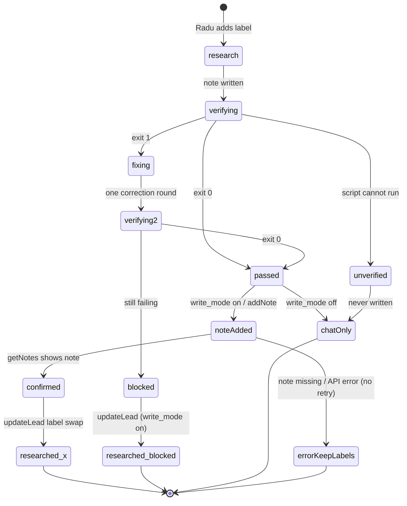

# 04. Hunting (Phase 1, plan 3.0)

Skill: `.claude/skills/hunting/SKILL.md` (~23 KB). Verifier: `scripts/verify_note.py`. Mode switch: `config/hunting-mode.md`. Triggered when Radu says "hunting".

**Question it answers:** why call this company now, and what exactly to say. **One goal: get the meeting.** No solutions, products, prices or financing in the note.

## 4.1 End-to-end sequence



If context gets heavy: stop **after** the current company and report done / left. With `write_mode: on`, labels show where to resume after `/clear`.

## 4.2 Per-company reasoning order

What does it do? → Is there a trigger? → Which one? → What process can it affect? → What is the probable problem? → Enough reason to call? → HIGH / MEDIUM / LOW.

### Step 0: identity check (blocking)
- CUI and name must be the same company (ListaFirme, or Termene / Risco / Targetare). Watch brand vs. legal name.
- CUI points to another company → write only `⚠ VERIFICARE: CUI și denumire nu se potrivesc — [detalii]`, next company.
- CUI is a one-digit typo for the same firm → continue, show `CUI [corect] (în Pipedrive: [greșit])`.

### Data sources and their rules
| Source | Rule |
|---|---|
| Pipedrive lead | Person (decision maker), phones, existing notes (non-Voldi notes = Radu's context, never modified), custom fields matched **by name** via the field map. `Lead - Status CRM` is internal context, never in the note. |
| `[CIFRE-LEADBRIDGE]` in "Observații" | Used only if `Extras:` date < 90 days and all four lines parse. Provides employees, secondary offices, founding year, revenue/profit (sizing only), active phones. |
| Person's function | Risco / TotalFirme first; else ListaFirme once; else "funcție necunoscută". Never guessed. |
| ListaFirme | One visit per company, read everything in that visit. Financials in EUR. Never from snippets or AI summaries. |
| Web | Own site, news, SEAP/SICAP, new sites, job ads (eJobs, BestJobs, LinkedIn Jobs, careers page). |

## 4.3 Priority classification



Not a specific fact: CAEN, "transport rutier" or any industry label, HQ address, employee counts, financial figures, registry data (number of branches, age), empty site counters ("0 +").

Special cases:
- **Group site**: counts as the company's site only if the Pipedrive email domain equals the site domain. Then the opening says "pe site-ul grupului".
- **Subsidiary of a foreign group**: add `- Cine decide: în România sau la grup? [?]` to CE TREBUIE SĂ AFLI.
- Job-ad role → process: dispatchers/drivers → fleet and routes; warehouse staff → stock; call center/reception → calls and bookings; new location → processes to replicate.

## 4.4 Note formats (Romanian, exact)

Full note (HIGH / MEDIUM):
```
[VOLDI-RESEARCH] Hunting | {Firmă} | {ZZ.LL.AAAA}

PRIORITATE: {HIGH / MEDIUM / LOW} — {motiv, 1 rând}

━━ CUI SUNI ━━
{Nume} — {funcție din registre / funcție necunoscută}
{ALTE NUMERE: …  only active numbers not already in Pipedrive}
PROBABIL ÎL INTERESEAZĂ: {criteriu relevant pentru rol} [I]

━━ BUSINESS ━━
CE FACE: {activitatea reală} [F]
CUM FACE BANI: {produs / serviciu / canal} [F/I]
CINE ESTE: {angajați} | {ani} | {locații} [F]
FAPT SPECIFIC 2: {fapt} [F] {link}        (optional, 3, 4 …)

━━ DE CE ACUM ━━
TRIGGER: {fapt + dată + link, same line} [F] / NONE FOUND
CONTEXT INDUSTRIE: {fapt din radar + fișier + link + dată} [F]   (optional)
OPORTUNITATE / AMENINȚARE: {…} [I]
IMPACT PROBABIL: {proces / cost / timp / risc / venit} [I]

━━ HOOK ━━
{1 propoziție: trigger + business} [F/I]            (with TRIGGER)
DIN ACTIVITATE: {cel mai bun fapt specific} [F] {link}   (TRIGGER NONE FOUND)

━━ DESCHIDERE ━━
„Bună ziua, {nume}? Radu, Vodafone Business.
{Hook}.
Lucrez cu firme din {industrie} pe partea de {proces}, ca să {beneficiu}.
Vă propun să stabilim un moment pentru o discuție de 20 de minute.”

━━ DACĂ NU ACCEPTĂ ━━
„Cum gestionați acum {procesul}?”
„Ce s-a schimbat la dumneavoastră de când {trigger}?”
„Cine se ocupă de partea asta la voi?”

━━ CE TREBUIE SĂ AFLI ━━
- Proces actual [?]
- Urgență / impact [?]
- Cine decide / cine influențează [?]

━━ SURSE ━━
{titlu, publicație, dată, link}
```

Short note (LOW only): header ends `| NOTĂ SCURTĂ`; sections CUI SUNI, BUSINESS (CE FACE, CINE ESTE), DESCHIDERE, SURSE only. Research limited to lead data, CIFRE block, one registry lookup, one search for an own site.

Writing rules worth knowing:
- Tags: `[F]` fact (link + date), `[I]` hypothesis, `[?]` to find out on the call.
- `PROBABIL ÎL INTERESEAZĂ` picks one course criterion (necessity, money, time, safety/urgency, comfort, image/status) phrased concretely.
- Opening = greeting → hook → what Radu does for them (tied to the person's function and the hook) → invitation **without day, date or time**, ending exactly at "…pentru o discuție de 20 de minute.”".
- Line 2 of the opening may contain only the hook or `[F]` facts; no unsourced "în creștere", "lider", etc.
- The template benefit "mai puțin timp cu operațiunile zilnice" is banned and the benefit sentence must not repeat across notes.
- No financial figures in the note at all; employees and locations only on `CINE ESTE`.
- No FEEDBACK block (removed 06.10.2026).
- After the note, outside it: one line per source checked, including "nimic" and "blocat".

## 4.5 Pipedrive write state machine (per lead)



Note content is sent as simple HTML: escape `&`, `<`, `>`, join lines with `<br>`, no trailing `/` before `)` in URLs, no HTML comments. Only `addNote` and `updateLead` with `label_ids` are allowed; label swap keeps every other label and re-reads `label_ids` right before the call.

## 4.6 Trial results recorded in plan 3.0 Status

| Trial | Leads | Rule | Result | Time |
|---|---|---|---|---|
| 1 (06.10) | 5 transport firms | old rule | 5/5 LOW | n/a |
| 1 re-run | same 5 | new rule (HIGH = trigger, MEDIUM = specific fact) | 0 HIGH, 3 MEDIUM, 2 LOW | n/a |
| 2 (06.10) | 5 new leads | new rule | 0 HIGH, 3 MEDIUM, 2 LOW, 0 verifier violations | ~7.5 min per company |

At that time 171 leads carried `research`, estimated ~18 hours. `config/hunting-mode.md` now says `write_mode: on` and `settings.json` has `addNote`/`updateLead` in `allow`, so automatic writes are enabled. The 3.0 Status section does not record when this switch happened.

## Dossier (Phase 2): specified, not built

Defined in `updates/voldi-3.0.md` §7, planned for 3.1 but 3.1 became the lot pipeline instead.
- Start: Radu says "fă dosar pe X" after a meeting is booked.
- Inputs: hunting note, Radu's dictated call feedback, newest radar, solution catalog.
- Content: context (what came out of hunting + working hypothesis), preliminary SWOT (S/W internal, O/T external incl. triggers and radar), top 3 hypotheses, PQP grid with `+ − = ?` (competition pre-filled from Pipedrive operator, timing from contract expiry, buying center from the call), top 3 PQP to clarify, 5 meeting questions each mapped to the hypothesis/criterion it resolves, directions to explore (problem → process → direction → standard / Sxx with DSC / new need).
- After the meeting Radu dictates; Voldi adds a new dated note, never edits the dossier.
