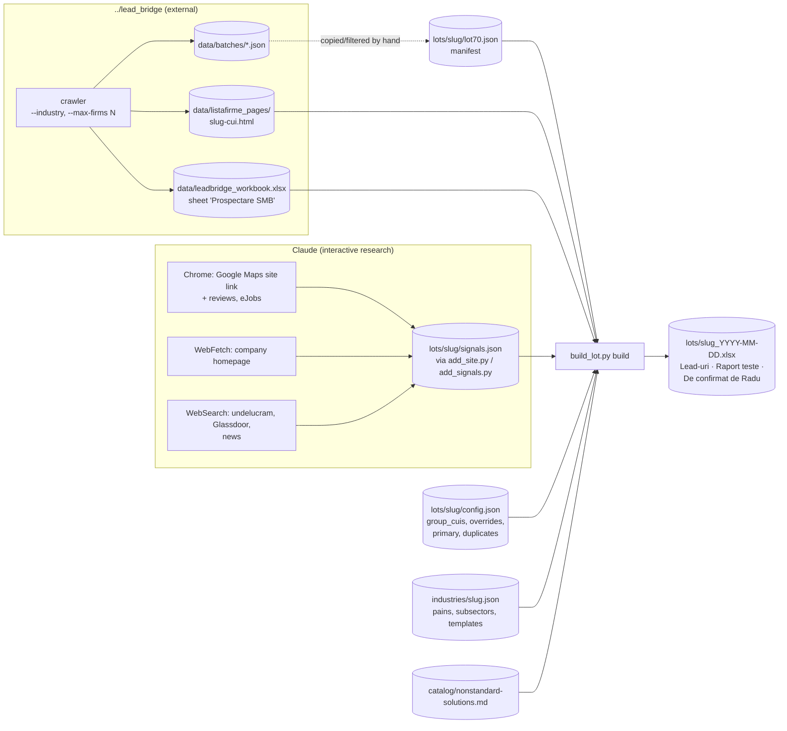
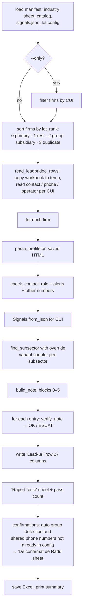
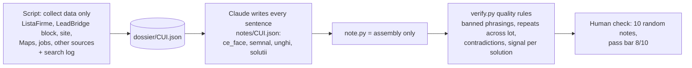

# 05. Lot pipeline (plan 3.1, script-first)

Entry point: `scripts/build_lot.py`. Library: `scripts/lead31/` (`profile.py`, `note.py`, `verify.py`, `group.py`, `catalog.py`). Data: `industries/<slug>.json`, `lots/<slug>/`. Tests: `tests/test_lead31.py` (33 tests).

**Goal (3.1):** "an Excel with 50 wholesale leads, each with a complete, tested research note", with as little Claude as possible. **No Pipedrive import.** Built and run on 12.10.2026 for CAEN 46 (wholesale), 70 firms.

## 5.1 Data flow



## 5.2 Commands

```powershell
# list firms of a manifest (name, CUI, locality, website from ListaFirme)
..\lead_bridge\.venv\Scripts\python.exe scripts\build_lot.py prepare --manifest lots\distributie-angro\lot70.json

# build the Excel
..\lead_bridge\.venv\Scripts\python.exe scripts\build_lot.py build `
    --manifest lots\distributie-angro\lot70.json `
    --industry distributie-angro `
    [--signals lots\distributie-angro\signals.json] `   # default: lots/<industry>/signals.json
    [--out path.xlsx] `                                 # default: lots/<industry>_<today>.xlsx
    [--only CUI,CUI] `                                  # subset for trials
    [--print]                                           # print notes to terminal
```

Exit code of `build`: `0` if every note passed verification, `2` otherwise.

Path constants in `build_lot.py`: `REPO = parents[2]` of the script = `C:\ai_projects`; `PAGES_DIR = REPO/lead_bridge/data/listafirme_pages`; `WORKBOOK = REPO/lead_bridge/data/leadbridge_workbook.xlsx`; `LOTS_DIR = voldi/lots`.

## 5.3 `cmd_build` step by step



Excel `Lead-uri` columns: Nr., Firmă, CUI, ListaFirme (hyperlink "Deschide"), Industrie, CAEN, Contact, Rol contact, Telefon (LeadBridge), Nr. telefoane ListaFirme, Decizie ("decizie la grup" / "duplicat"), Lot, Administrator(i), Asociați, Angajați, Județ / localitate, Bloc 0 … Bloc 5, Nota completă, Teste, Probleme teste, Status CRM (empty), Notă apel (empty, comment shows format `data | rezultat (C/R/D/FU) | ce a zis clientul, cu cuvintele lui | următorul pas`). Header fill `E60000` (Vodafone red), panes frozen at C2.

## 5.4 Module reference

### `lead31/profile.py`
- `parse_profile(html, url) -> Profile`: uses LeadBridge's `extract_company_page` and `extract_cifre`, plus local regex for CAEN (code, rev, label from "Obiect Activitate"), administrators (`#adm` pane), associates with share (`#asoc` pane), phone numbers ("Telefon" and "Mobil" rows, `tel:` links), county, locality, website ("Adresă web"). `logged_out = cifre.active_phone_count is None`.
- `is_legal_entity(name)`: legal form token (SRL, SA, GMBH, LTD, HOLDING, …) or an all-caps name with 2+ words (ListaFirme writes people in mixed case).
- `same_person(a, b)`: diacritics-insensitive, word-order-insensitive comparison.
- `check_contact(profile, name, phone) -> ContactCheck`: role = administrator / administrator și asociat (share) / asociat (share) / "angajat sau altă persoană"; alerts when no contact, contact not administrator (lists admins), contact is a legal entity; `other_numbers` = ListaFirme numbers different from the LeadBridge phone.

### `lead31/note.py`
Constants: `REVIEW_WINDOW_DAYS = 62`, `JOBS_WINDOW_DAYS = 92`, `SUBSECTOR_TAG = "IPOTEZĂ (tipic subsector)"`, `GROUP_BLOCKED = {"S01", "S04"}` (ERP, WMS).

`Signals` (from `signals.json`): `reviews`, `jobs`, `news`, `reviews_source`, `jobs_source`, `site`, `rj_pending`, `checked` (legacy). Derived: `site_state` ∈ `ok` / `fără site` / `căutare eșuată` / `negăsit` (legacy) / `necercetat`; `search_log`; `site_facts` (only when status `ok`, facts with url + text).

**Pain scoring (`score_pains`)**, per pain P1..P7 of the industry sheet:

| Evidence | Condition | Score | Lead-in for first question |
|---|---|---|---|
| Job ad | title matches any `job_regex`, dated within 92 days, has url | +2 each | "Am văzut anunțul pentru „{title}”" |
| Review | quote matches any `review_regex`, within 62 days | +2 each | "Într-un review din {date} am văzut o plângere" |
| Site fact | `fact.pain == pain.id` | +3 each | "Pe site scrie că {text}" |
| Profile hint | `profile_hint == "secondary_offices"` and ≥ 1 secondary office | +1 | "Aveți N sedii secundare" |

Then the subsector (matched by regex on the folded CAEN label, or forced by `subsector_override`; `"none"` disables it) is appended as a **baseline pseudo-pain** with score 0.5 and kind `subsector`. Hits are sorted by score desc, then id.

**Solution pick (`_pick_solutions`)**: only hits with a kind in {job, review, site, subsector} are usable (profile-only hints give questions, never solutions). Pass 1 takes the first catalog card (in sheet order, skipping `S01/S04` for group subsidiaries) from each usable hit until 2 picks. Pass 2 fills the second slot from the same hits if needed. Card status text: `OK-E` or `?-E (de confirmat cu Eduard)`.

**Blocks:**

| Block | Built by | Content |
|---|---|---|
| 0 | `block0` | "Cu cine vorbești: {name} — {role}, telefon {phone} (ListaFirme + LeadBridge)." + `⚠ ALERTĂ: …` (contact alerts, group line "filială de grup — decizia probabil la nivel de grup", duplicate line) + other numbers |
| 1 | `block1` + `site_line` | "Firma: {CAEN label}. {money sentence} CAEN · since/years · employees (year) · revenue RON (year) · secondary offices · place. Sursă: ListaFirme {url}" then "Pe site: …" (facts with links, or the site state text). The CAEN money template is dropped when site facts exist. |
| 2 | `block2` | Weak reviews in last 62 days (max 2, quote + platform + date + url) or "nimic găsit ({reviews_source})" or NECERCETAT |
| 3 | `block3` | Job ads in last 92 days (max 3) or "nimic găsit ({jobs_source})" or NECERCETAT |
| 4 | `block4` | "Unde pierde bani/timp —" top 2 usable hits: subsector baseline tagged `IPOTEZĂ (tipic subsector)`, signal hits tagged `IPOTEZĂ` with evidence; or "nu presupun nimic, aflu în apel" |
| 5 | `block5` + `build_questions` | "Principală/Secundară: {Sxx} {name} — {status}; durere: …; probabil n-au …" or "nicio soluție potrivită"; then "Întrebări de descoperire" with 3 questions: Q1 = lead-in from the strongest hit with a lead-in (else a profile lead-in "Cu N angajați și …") + a question of that pain rotated by `variant`; Q2–Q3 = rotated from the pool (picked pains' questions + all hits' questions + `generic_questions`) |

`variant` is a per-subsector counter so firms in the same subsector get different questions.

### `lead31/group.py`
- `detect_group(profile, site_facts)`: reasons = majority (≥ 50 %) associate that is a legal entity; foreign legal form in the company name (GMBH, AG, BV, NV, LTD, SPA, SAS, SAU, INC, LLC); a site fact matching "parte din / membru al / filială a … grup / holding / concern" or "grupul X".
- `shared_numbers(profiles)`: pairs of firms in the lot showing the same phone number (possible duplicates).
- Policy: Radu's `group_cuis` list is the source of truth; detections are only reported in the "De confirmat de Radu" sheet.

### `lead31/catalog.py`
Parses `catalog/nonstandard-solutions.md` lines `**Sxx · Name**` followed by `- STATUS: OK-E|?-E` into `Card(id, name, status)`.

### `lead31/verify.py`
See [07-verification-and-tests.md](07-verification-and-tests.md#72-lead31verifypy-lot-notes).

## 5.5 Research step done by Claude (method from 3.1-HANDOFF)

1. Site URL: Chrome → `https://www.google.com/maps/search/<firm+locality>`, wait 3 s, JS `document.querySelector('a[data-item-id="authority"]')?.href`; 6 firms per `browser_batch`. Wrong firm/list → WebSearch → else status.
2. Read site: WebFetch homepage (5–6 in parallel) with a fixed prompt (is the firm/CUI mentioned, what it sells, to whom, how clients order, warehouses/points of sale, delivery/fleet, short quotes). On SSL/403: Chrome + `document.body.innerText`.
3. Store: `python lots/distributie-angro/add_site.py '{"CUI":{"status":"ok","url":…,"facts":[{"topic","text","url","pain":null|"P1".."P7"}]}}'`. Tag `pain` only when the site clearly shows it (P2 own fleet, P3 several warehouses, P1 agents/orders, P6 phone…).
4. eJobs: pauses of 4–8 s against Cloudflare; WebSearch cannot open eJobs.
5. Extended sources (undelucram.ro, Glassdoor, Facebook, news): only items with source + date.

## 5.6 What happened (12–13.10.2026)

- 70 firms crawled ("caen 46", workbook rows 1078–1147). The LeadBridge selection also contained other counties and CAEN 45xx; 50 chosen as primary (CAEN 46, 5–49 employees, 35 Bucharest + 15 Ilfov), 20 "rest", 10 group subsidiaries placed last.
- Run results: 70/70 notes passed the tests. Signals found: 3 recent job ads, **0** weak reviews in 2 months, 0 news. Only 2 firms got a recommended solution in the first 50-note run.
- Current `signals.json` (70 entries): site status `ok` 43, `negăsit` 27; 0 entries with `search_log`; 0 reviews, 3 jobs, 0 news.
- Radu's audit of 51 used notes (plan 3.2): notes were generic. Diagnosis: "no sentence in the note is written for that specific company". Details and the fix plan are in [11-known-issues-and-open-questions.md](11-known-issues-and-open-questions.md).

## 5.7 Plan 3.2 target design (not implemented as a whole)



Phases: 1 mechanical fixes, 2 script/Claude split, 3 deeper sources per company (Maps sorted by newest, undelucram/Glassdoor, eJobs + careers page, inner site pages, Facebook/LinkedIn/SICAP), 4 new note ≤ 12 lines, 5 quality tests, 6 validation on the 51 firms. Phase 1 items are visible in the current code (separate `jobs_source`, site states with search log, `is_legal_entity`, group blocking of S01/S04, `detect_group`, `shared_numbers`, removal of `uniquify_questions`, CAEN 463 no longer a cold-chain hint), although the 3.2 Status line still says no code was changed.
