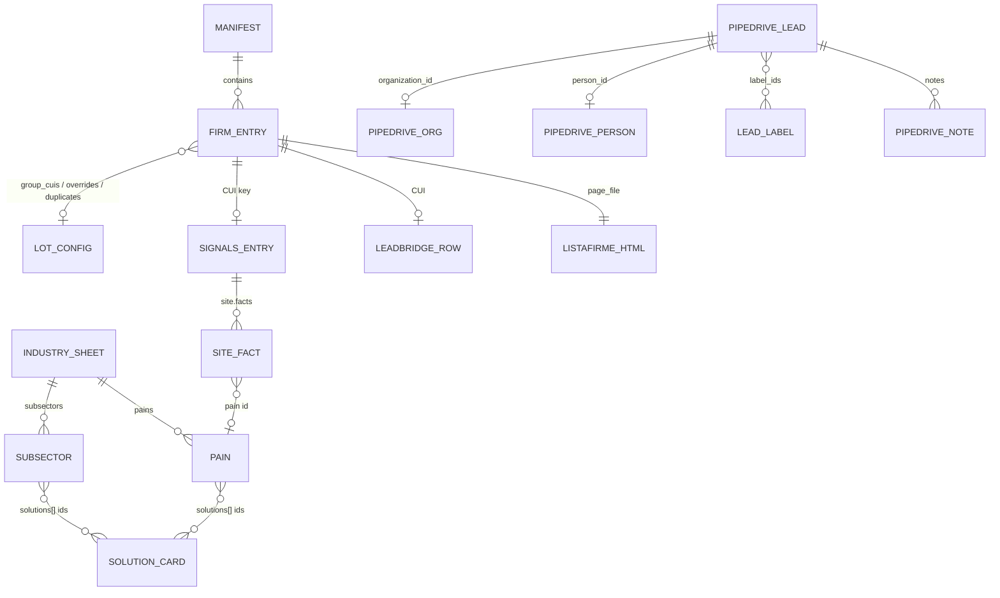
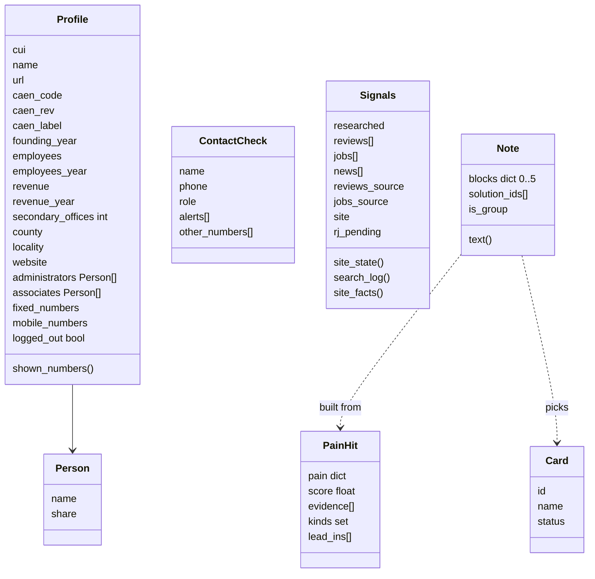

# 06. Data model

Voldi has no database. Everything is files (JSON, Markdown, Excel) plus Pipedrive. This page lists every format.



The lot side (top) and the Pipedrive side (bottom) are **not linked** by any code today; the only shared key would be the CUI (stored as an Organization custom field in Pipedrive, read by `pipedrive_read.py`).

## 6.1 Batch manifest: `lots/<slug>/lot*.json`

```json
{
  "industry": "Distribuție angro",
  "firms": [
    {
      "cui": "6104191",
      "company_name": "HYUNDAI AUTO ROMANIA SRL",
      "row_index": 1078,
      "page_file": "hyundai-auto-romania-srl-6104191.html",
      "url": "https://platform.listafirme.ro/hyundai-auto-romania-srl-6104191/"
    }
  ]
}
```
`row_index` = row in the LeadBridge workbook. `page_file` is resolved under `lead_bridge/data/listafirme_pages/`. The ListaFirme URL is rebuilt from the file stem (`listafirme_url`). Files present: `lot50.json` (first 50), `lot70.json` (all 70), `lot51_cuis.txt`, `_recheck.json`.

## 6.2 Signals: `lots/<slug>/signals.json`

Object keyed by CUI. One entry:

```json
{
  "reviews": [ {"quote": "...", "platform": "Google Maps", "date": "2026-09-20", "url": "https://..."} ],
  "jobs":    [ {"title": "Economist", "platform": "eJobs", "date": "2026-10-02", "url": "https://www.ejobs.ro/..."} ],
  "news":    [ {"title": "...", "date": "...", "url": "..."} ],
  "reviews_source": "Google Maps (primele review-uri afișate, sortate după relevanță)",
  "jobs_source": "eJobs (căutare după numele firmei)",
  "checked": "legacy free text, no longer displayed",
  "rj_pending": false,
  "site": {
    "status": "ok | fără site | căutare eșuată | negăsit (legacy)",
    "url": "http://www.example.ro/",
    "facts": [ {"topic": "vinde", "text": "…", "url": "http://…", "pain": null} ],
    "search_log": [ {"query": "…", "engine": "web | maps", "result": "…"} ],
    "note": "free text when not found (legacy)"
  }
}
```

Rules enforced in code:
- Dates: `YYYY-MM-DD` or `YYYY-MM`; items without a date in the window or without a url are ignored (`recent()`).
- `rj_pending: true` (entry created only with site facts) → blocks 2 and 3 show NECERCETAT and fail verification.
- Missing entry → everything NECERCETAT → fails.
- `fără site` needs a `search_log` with results from both `web` and `maps` engines; `căutare eșuată` needs any search log; legacy `negăsit` always fails.

Helpers: `add_signals.py '<json>'` merges whole entries; `add_site.py '<json>'` replaces only the `site` key (creating `{"reviews":[],"jobs":[],"checked":"","rj_pending":true}` if the CUI is new); `add_site_file.py` reads the same from a file.

## 6.3 Lot config: `lots/<slug>/config.json`

```json
{
  "group_cuis": ["6104191", "..."],                 // subsidiaries: last in Excel, "decizie la grup", S01/S04 blocked
  "subsector_override": {"15120749": "SS-echipamente-tehnice", "<cui>": "none"},
  "lot_primary_cuis": ["..."],                     // the 50 primary firms
  "duplicates": {"<dup cui>": "<active cui>"}      // dup row marked "duplicat", sorted last
}
```

## 6.4 Industry sheet: `industries/<slug>.json`

Top-level keys: `slug`, `name`, `caen_prefixes` (["46"]), `generated` (date), `note`, `money_templates`, `pains`, `generic_questions`, `subsectors`.

`money_templates`: keyed by CAEN 3-digit prefix with `default`, e.g. `"461"` = "Intermediază vânzări… câștigă din comision."

`pains[]` (wholesale sheet):

| id | title | solutions (order = best first) | profile_hint |
|---|---|---|---|
| P1 | comenzi preluate de agenți și la telefon | S01, S05, S93, S51 | |
| P2 | livrări cu mașini proprii | S05, S09, S57, S08 | |
| P3 | stoc și depozit | S04, S55, S01 | secondary_offices |
| P4 | marfă cu temperatură controlată | S10, S56, S22 | |
| P5 | facturare și documente | S02, S01 | |
| P6 | telefonul firmei | S51, S86, S89, S93 | |
| P7 | comenzi online | S53, S54, S01 | |

Each pain also has `problem` (sentence), `job_regex[]`, `review_regex[]` (matched against diacritic-folded lowercase text) and `questions[]`.

`subsectors[]`: `id`, `name`, `match_label[]` (regex on folded CAEN label), `title`, `problem`, `solutions[]`, `questions[]`. Wholesale has 9: SS-intermediar, SS-alimente-frig, SS-alimente-bauturi, SS-farma-medical, SS-electrice-it, SS-echipamente-tehnice, SS-constructii, SS-auto-chimice, SS-nespecializat.

`generic_questions`: 2 fallback questions ("Cum arată o zi obișnuită…", "Unde pierdeți cel mai mult timp…"), both banned as phrasings by the 3.2 plan.

## 6.5 Solution card: `catalog/nonstandard-solutions.md`

```
## <Category>

**S05 · <Name>** (optional short explanation)
- Piață RO: [vendor](url), …           (proof the thing exists on the market)
- Sursă publică: [Vodafone page](url) | —
- Exemplu la altă firmă: [case](url)
- Partener Vodafone (neconfirmat de Eduard): …
- STATUS: ?-E | OK-E (date)
- Notă internă: …
```

Categories: Administrativ și vânzări, Flotă și transport, Șantier și echipe pe teren, HoReCa și retail, Producție și depozit, Agricultură, Utilități, Portofoliul Vodafone Business (S58–S106 added 12.10.2026 from Radu's portfolio list, all `?-E`, no verified public pages). Parsed by `lead31/catalog.py` (only id, name, status). Not read by radar or hunting. `standard-solutions.md` is empty.

## 6.6 In-memory types (Python)



## 6.7 Pipedrive

Lead labels (from `config/pipedrive-field-map.md`):

| ID | Name | Role |
|---|---|---|
| `ac9acf50-b284-11f1-9e1d-4f02e461d123` | research | hunting input |
| `2d617700-b286-11f1-8526-81f32602c305` | researched - high | output HIGH (formerly "Cercetat": older leads with that label look HIGH without having gone through hunting) |
| `29ad43a0-c163-11f1-ae48-037518f95c42` | researched - medium | output MEDIUM |
| `33aaa320-c163-11f1-ae48-037518f95c42` | researched - low | output LOW |
| `945641c0-c163-11f1-ae48-037518f95c42` | researched - blocked | failed verification |
| `67b6abf0-b597-11f1-85cb-d7bde5c4b8ac` | "de sunat azi" (name unverified) | Radu's own call-today label |

Lead custom fields (hash keys in the map): Operator actual (enum 39 Orange, 40 Digi, 41 Telekom, 42 Vodafone, 43 ?), Structura abonamente, Factura extra-cost, Factura lunara, Expirare contract, Lead - Status CRM (active key `e445d10a…`; a duplicate-named key looks unused), Person - Email (suggested) ×2 (look unused). Observații carries the `[CIFRE-LEADBRIDGE]` block. The CUI is an Organization custom field named "CUI".

Note convention: every Voldi note starts with `[VOLDI-RESEARCH]`; hunting notes with `[VOLDI-RESEARCH] Hunting | {Firmă} | ZZ.LL.AAAA`.

## 6.8 Config files

| File | Format | Read by |
|---|---|---|
| `config/hunting-mode.md` | one line `write_mode: on/off`; anything else = off | hunting skill |
| `config/product-blocklist.md` | one term per line; `#`/`>` header; `!prefix` = allowed word prefix; terms before `@oriunde` checked only in spoken sections, after it in the whole note except SURSE | `verify_note.py` |
| `config/pipedrive-field-map.md` | markdown tables; the field table between `<!-- refresh_field_map: start/end -->` is regenerated by `refresh_field_map.py` | hunting skill, humans |
| `.claude/settings.json` | Claude Code permissions | Claude Code |

## 6.9 Radar file

Plain text in the format of [03-radar.md](03-radar.md), file name `radar-YYYY-MM-DD[-n].md`. The date in the file name is what hunting uses for the 14-day freshness check.
