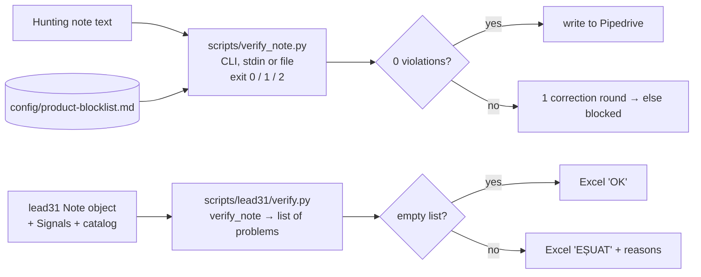

# 07. Verification and tests

Voldi relies on **mechanical verifiers** (regex, no model) to catch rule violations in notes the model or templates produce. There are two, one per pipeline. Both check form, not usefulness.

## 7.1 `scripts/verify_note.py` (hunting notes)

Usage: `verify_note.py <file | -> [blocklist.md]`. Reads UTF-8 bytes from stdin with `-`. Default blocklist `config/product-blocklist.md`. Exit `0` = "0 abateri mecanice.", `1` = violations listed, `2` = usage error or unreadable blocklist. The skill runs it from Bash with a heredoc (not PowerShell) to avoid encoding problems.

Checks, in code order:

| Area | Rule |
|---|---|
| Header | First line matches `[VOLDI-RESEARCH] Hunting \| … \| DD.MM.YYYY` (+ optional `\| NOTĂ SCURTĂ`); a `PRIORITATE: HIGH/MEDIUM/LOW — reason` line exists |
| Sections | Full note: CUI SUNI, BUSINESS, DE CE ACUM, HOOK, DESCHIDERE, DACĂ NU ACCEPTĂ, CE TREBUIE SĂ AFLI, SURSE (no unknown sections). Short note: CUI SUNI, BUSINESS, DESCHIDERE, SURSE |
| Labels | CUI SUNI: `PROBABIL ÎL INTERESEAZĂ:`; BUSINESS: `CE FACE:`, `CUM FACE BANI:`, `CINE ESTE:`; DE CE ACUM: `TRIGGER:`, `OPORTUNITATE / AMENINȚARE:`, `IMPACT PROBABIL:` (short note: CE FACE, CINE ESTE) |
| Leftovers | No `FEEDBACK`; no `{…}` placeholder |
| Money | Outside SURSE and URLs: no `lei`, `RON`, `EUR`, `€`, preț, rată/rate, eligibil, finanțare, avans, leasing, tarif, discount, "luni de contract", "pe N ani/luni", "pe lună", "/lună", lunar |
| Financials | No revenue/profit/debt word within 25 chars of a number (either order) |
| Products | Terms after `@oriunde` (Vodafone/partner product names: Smart Invoice, Cloud Voice, SoftPOS, easySales, Microsoft 365, …) anywhere except SURSE; terms before it (Excel, Word, Glovo, Wolt, Bolt, WhatsApp, Booking, Facebook, Instagram, TikTok, Google Maps, Tripadvisor) only in spoken sections and non-TRIGGER lines of DE CE ACUM. Word-prefix match, case-insensitive, `!excelen`, `!boltă` … exempt |
| Short note | Only LOW; no `FAPT SPECIFIC` lines |
| TRIGGER = NONE FOUND | HOOK is exactly one line `DIN ACTIVITATE: …`, one sentence; PRIORITATE must be MEDIUM |
| TRIGGER = fact | Contains `[F]`, URL and date on the same line; no `radar-` reference; not older than 183 days vs. note date; PRIORITATE must be HIGH |
| CONTEXT INDUSTRIE | `[F]` + URL + date on the line |
| Specific facts | Each `FAPT SPECIFIC n` / `DIN ACTIVITATE` line: `[F]`, URL, not generic (CAEN, "N angajați", "0 +", HQ address, street names); its URL appears in SURSE on a line with a date not older than 731 days |
| Sources | If any `[F]`/`[F/I]` exists, SURSE has at least one URL |
| Opening | Last line ends with "pentru o discuție de 20 de minute.”"; no weekday, month, "mâine", "azi", clock time or "ora"; no "NONE FOUND"; no "mai puțin timp cu operațiunile zilnice"; line 2 has no "în creștere / în expansiune / în dezvoltare / lider / de succes" |

Date parsing accepts `DD.MM.YYYY`, `YYYY-MM-DD` and Romanian month abbreviations + year (first of month).

Not checked by the script (left to the model): email domain vs. site domain for group sites, identity check, phone de-duplication, whether facts are true.

## 7.2 `lead31/verify.py` (lot notes)

`verify_note(note, signals, catalog, today) -> list[str]`; empty = pass.

| # | Rule |
|---|---|
| 1 | Blocks 0–5 present (stop early if not) |
| 2 | ≤ 16 non-empty lines |
| 3a | Block 0 mentions "ListaFirme"; block 1 first line has a URL; block 1 has a "Pe site:" line |
| 3b | Site: NECERCETAT fails; `ok` with facts needs ≥ min(facts, 5) URLs; `ok` without facts must say "fără fapte utile"; `fără site` needs search log entries with results from both `web` and `maps`; `căutare eșuată` needs a search log; legacy `negăsit` fails |
| 3c | Blocks 2/3: NECERCETAT fails; "nimic găsit" fails if recent items exist; content without recent items fails ("text inventat?"); enough URLs |
| 3d | Block 3 must not mention "Google Maps" (old bug: reviews source printed under job ads) |
| 4 | Block 4 contains "IPOTEZĂ"; if block 5 uses a subsector hypothesis, block 4 has "IPOTEZĂ (tipic subsector)" |
| 5 | Every `Sxx` in block 5 exists in the catalog, has a status, the status is displayed, `?-E` cards say "de confirmat cu Eduard" |
| 6 | Group subsidiary: no S01/S04; block 0 contains "decizia probabil la nivel de grup" |
| 7 | With solutions: "probabil" and "IPOTEZĂ" present; without: "nicio soluție potrivită"; max 2 solutions |
| 8 | ≥ 2 discovery questions; Q1 starts with "Am văzut", "Pe site scrie", "Aveți", "Într-un review" or "Cu <digit>"; every question ends with "?" |
| 9 | Every news item has url and date |

Plan 3.2 notes that rule 8 actually whitelists the template openings it wanted to eliminate ("Aveți…", "Cu 49 angajați…").

## 7.3 Product blocklist

`config/product-blocklist.md` has two groups separated by the `@oriunde` line. It was extended on 06.10.2026 with solution names from the catalog so hunting notes never name a product. The lot pipeline does **not** use the blocklist, because its block 5 is meant to name catalog solutions.

## 7.4 Test suites

Run from `voldi/`: `..\lead_bridge\.venv\Scripts\python.exe -m unittest discover -s tests -p "test_*.py" -v`

| File | Test methods | Covers |
|---|---|---|
| `tests/test_verify_note.py` | 53 | hunting verifier rules |
| `tests/test_lead31.py` | 33 | profile parsing, contact roles/alerts, legal entity, signals windows, site states, scoring, solution pick, group blocking and detection, duplicates, question rules, CAEN 463 regression, `uniquify_questions` removed, every sheet solution exists in catalog, only S01 is OK-E |
| `tests/test_pipedrive_client.py` | 11 | token loading, token never leaked in errors |
| `tests/test_pipedrive_read.py` | 13 | label lookup, pagination, field extraction |
| `tests/test_pipedrive_write.py` | 11 | add-only note writing, marker prefix |
| **Total** | **121** | |

Last recorded results: plan 3.0 Status 88/88 (06.10); plan 3.1 Status "voldi 105/105" and "tests.test_lead31 20/20" (12.10). `test_lead31.py` now has 33 methods, so it changed after the last recorded run. I did not run the tests; current pass state: **I cannot confirm.** `test_lead31.py` imports LeadBridge (`leadbridge.html_extractor`), so it only runs where `../lead_bridge/src` exists.

## 7.5 Review checklist (plan 3.0)

Voldi is told to run this on its own output before each report: verify the file on disk, not text pasted in chat; every `[F]` has source and date, drafts marked; `[I]` describes pressure, not current practice; zero solutions/products/prices/financing in radar and hunting notes; no Pipedrive write except addNote + label_ids, and only with `write_mode: on`.
