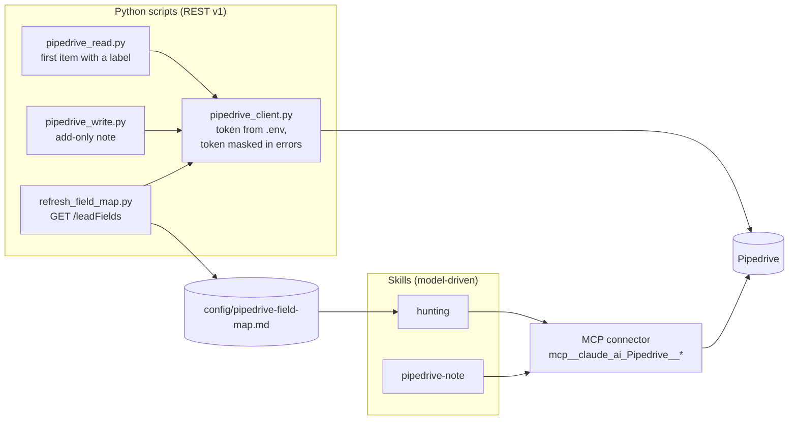
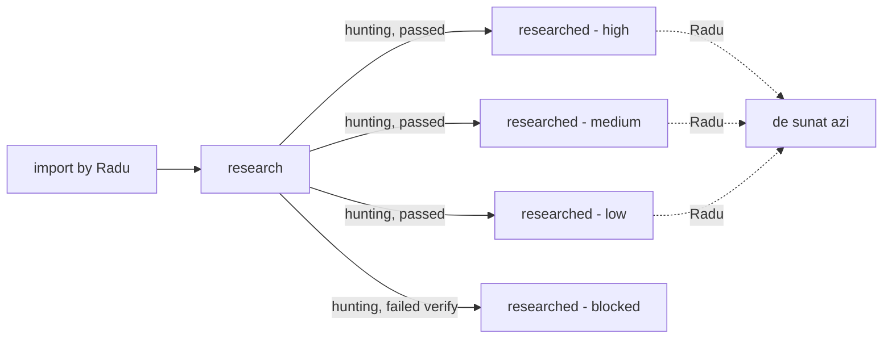

# 08. Pipedrive integration

Pipedrive is the CRM where leads live and where hunting notes end up. Voldi reaches it in **two independent ways**.

In practice the **skills use the connector**; the scripts are from the September "Researcher skeleton" and are no longer used by any skill (`pipedrive_write.py` is kept as add-only, with no labels). `refresh_field_map.py` is still the way to regenerate the field map.

## 8.1 Permissions (`.claude/settings.json`)

| List | Entries |
|---|---|
| allow | `mcp__claude_ai_Pipedrive__addNote`, `mcp__claude_ai_Pipedrive__updateLead` |
| ask | `Bash(*pipedrive_write.py*)`, `mcp__claude_ai_Pipedrive__updateDeal`, `mcp__claude_ai_Pipedrive__updateOrganization` |
| deny | `mcp__claude_ai_Pipedrive__updateNote`, `mcp__claude_ai_Pipedrive__delete*` |

Also: `skillOverrides.caveman = "user-invocable-only"` so the terse style never activates by itself.

Note: the hunting skill text still says addNote/updateLead are "on ask until Radu moves them to allow after the trial"; they are now in allow, consistent with `write_mode: on`.

## 8.2 What each actor may do

| Actor | Reads | Writes |
|---|---|---|
| hunting | `getLeads` (paged), `getLead`, `searchLeads`, `getPerson`, `getNotes` | `addNote`, `updateLead` with `label_ids` only, and only when `write_mode: on` |
| pipedrive-note | `searchLeads`/`searchDeals`, `getNotes` | one `addNote` per explicit "da", no label changes |
| lot pipeline | nothing | nothing |
| scripts | `/leadLabels`, `/dealFields`, `/leads`, `/deals`, `/organizationFields`, `/organizations/{id}`, `/persons/{id}`, `/leadFields` | `POST /notes` (pipedrive_write.py) |

Never, anywhere: `updateNote`, deletes, changes to any other field of lead/deal/person/organization.

## 8.3 Listing the hunting queue

The connector has no label filter. Method from the skill:
1. `getLeads` with `limit: 100`, `start: 0, 100, 200…` until `additional_data.pagination.more_items_in_collection` is false.
2. Each page (~75k characters) is saved to a file by the tool and filtered with `grep`/`jq` on `label_ids` for the `research` id; whole pages are never read into context.
3. Keep `id`, `title`, `person_id`, `organization_id` of non-archived leads.

## 8.4 Writing a hunting note

1. `addNote` with `lead_id` (uuid) and `content` = note as simple HTML (escape `& < >`, lines joined with ` `, no HTML comments, no trailing `/` right before `)` in URLs because Pipedrive auto-linking cuts it).
2. `getNotes` on the lead to confirm the note exists.
3. `getLead` to re-read current `label_ids`.
4. `updateLead` with `label_ids` = current − `research` + `researched - high|medium|low`. Nothing else in the call.
5. Any API error: report the exact text, do not retry, move on.
Blocked note: no `addNote`; `updateLead` with current − `research` + `researched - blocked`.

## 8.5 `pipedrive-note` skill (manual)

For one note on one lead/deal that Radu names. Refuses "all", filters or labels.
1. Find the target (`searchLeads`/`searchDeals`); zero or several matches → ask.
2. Read existing notes, tell Radu what is there.
3. Build the note: first line `[VOLDI-RESEARCH] ZZ.LL.AAAA` for free text; hunting notes keep their own header. Convert to simple HTML.
4. Block check (stop and show offending lines, do not self-fix): currency or sums, installments, advance, new contract duration, eligibility, financing, revenue/profit/debt figures. An existing contract's expiry as a date is allowed, with the calculation shown.
5. Show note + target, ask "Scriu nota asta pe [titlu] ([lead/deal] [ID])? da / nu". Only an explicit "da" for this note counts.
6. `addNote` once, no pin flags, no retry.
7. Confirm with `getNotes`; report note id and time.

## 8.6 REST scripts

- `pipedrive_client.py`: `load_api_token()` reads `PIPEDRIVE_API_TOKEN` from `voldi/.env`; `api_get/post/put/patch` with 30 s timeout; on HTTP error the token is replaced by `***` in the message; `find_custom_field_key(fields, name)` case-insensitive.
- `pipedrive_read.py --source leads|deals [--tag research]`: walks pages, returns JSON for the **first** item carrying the label: `item_id`, `source`, `company_name`, `cui` (Organization custom field "CUI"), `website`, `administrator` (Person name).
- `pipedrive_write.py --source leads|deals --item-id ID --note TEXT`: always `POST /notes`; prefixes `[VOLDI-RESEARCH] ` if missing. Prints "Researcher: notă nouă adăugată…".
- `refresh_field_map.py`: rewrites only the table between `<!-- refresh_field_map: start -->` and `end` in `config/pipedrive-field-map.md`, keeps Radu's notes, reports new/removed/renamed keys.

## 8.7 Label lifecycle

The "de sunat azi" label and call tracking are Radu's manual process; Voldi does not read call outcomes back.
