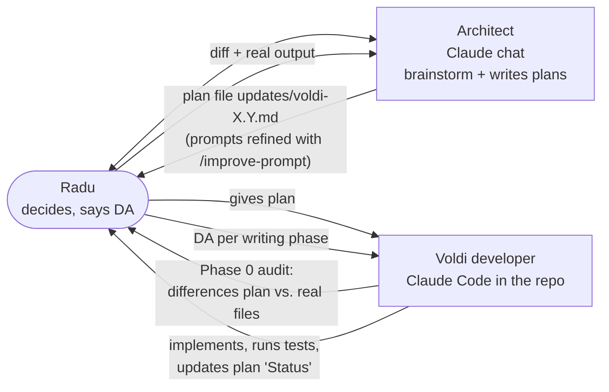
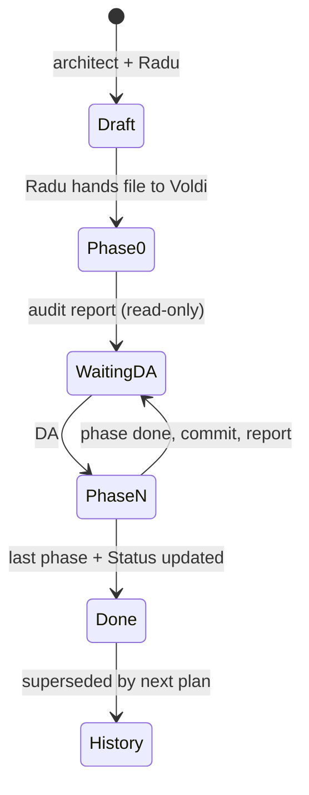
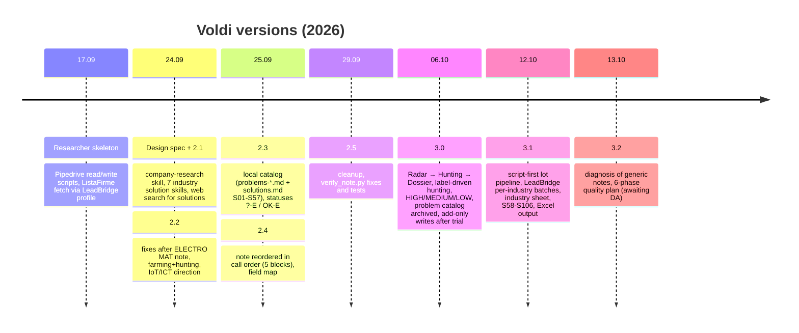

# 09. Build process and version history

## 9.1 Roles

- **Radu** decides; nothing is created, changed, moved or deleted without his explicit DA (except radar files).
- **Architect** (separate Claude chat) discusses freely, writes versioned plans, reviews results. It does not accept "test passed" without the diff and the real output (HANDOVER.md).
- **Voldi** (Claude Code) is developer and runtime at the same time: verifies the plan against the files, reports differences, implements phase by phase with a DA before each writing phase, commits at the end of each phase, and updates the plan's Status section.
- Radu often dictates in mixed Romanian/English; Voldi turns it into a clear task, uses `improve-prompt` if vague, asks one question only when a wrong guess is costly.

Builder tools (GSD, superpowers, worktrees) are allowed for building Voldi, not for researching companies.

## 9.2 Plan lifecycle

Rule in CLAUDE.md: the active plan overrides HANDOVER.md and older plans; older plans are history and are not read at runtime.

## 9.3 Version history

### Details per version

| Version | Date | Main decisions | Fate |
|---|---|---|---|
| Researcher skeleton | 17.09 | Separate "Researcher" tool: read first lead labelled `research`, fetch ListaFirme with LeadBridge's Playwright profile, write a new note. Research rules to come later. | Scripts still in `scripts/` |
| 2.1 | 24.09 | `company-research` skill with an 8-step research; 7 `solutions-<industry>` skills with a self-growing "Candidați" section F; strict rules (no DB, no scoring, no multi-agent). | Replaced |
| 2.2 | 24.09 | Fixes from the ELECTRO MAT note (corrupt text, wrong dates, duplicated statuses, contract-based opening, missing gatekeeper alert). Role becomes farming + hunting, telecom as door-opener for IoT/ICT. | Merged |
| 2.3 | 25.09 | Web search for Vodafone solutions dropped; one local, problem-first catalog; only two statuses `?-E` / `OK-E`. Reason: Radu's flow is need on call → ask Eduard → meeting. | Catalog kept, problem files archived in 3.0 |
| 2.4 | 25.09 | Note reordered to call order: ÎNAINTE → ÎN APEL → DACĂ SE CONFIRMĂ → REFERINȚĂ → FEEDBACK; Pipedrive field map. | Replaced by 3.0 format |
| 2.5 | 29.09 | One note format only; `verify_note.py` bugs fixed, tests added, verifier wired into the flow; stale docs. | Merged |
| 3.0 | 06.10 | New architecture Radar / Hunting / Dossier; hunting note's only goal is the meeting; solutions out of the note; label-driven batch; HIGH/MEDIUM/LOW; trial gate then automatic add-only writes; `problems-*.md` archived; `company-research` replaced by `hunting`. Later the same day: priority rule rewritten (HIGH = company trigger ≤ 6 months, MEDIUM = specific fact, LOW = short note), no day/time in invitation, FEEDBACK removed. | **Declared active in CLAUDE.md** |
| 3.1 | 12.10 | Volume mode: 50 firms per industry block; LeadBridge per-industry lists and N-firm batches; script-first research note blocks 0–5 with solutions; industry sheet; 49 new catalog cards; Excel output; no Pipedrive. Radu gave DA for all phases at once. | Implemented, in use, not mentioned in CLAUDE.md |
| 3.2 | 13.10 | Audit of 51 notes: generic, template-made. Plan: mechanical fixes, Claude writes all sentences, deeper sources with search logs, shorter note, quality tests, human 8/10 check. | Phase 0 done; Phase 1 fixes appear in code; rest pending |

## 9.4 Recurring patterns in the history

- Each version reacts to a concrete bad note (ELECTRO MAT in 2.2/2.4, the 5 transport firms in 3.0, the 51 wholesale notes in 3.2).
- The note format changed in 2.1, 2.4, 3.0 and 3.1; the solution question flipped between "web search", "catalog in note", "never in note" and "catalog in note" again.
- Verifiers grow alongside, and each time they end up enforcing form after the content problem has moved elsewhere.
