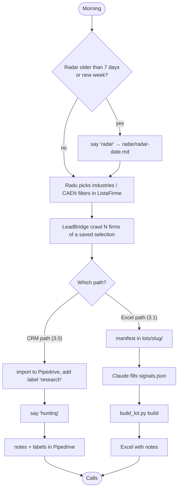

# 10. Runbook

## 10.1 Prerequisites

| Need | Detail |
|---|---|
| OS | Windows, repos side by side in `C:\ai_projects\` (`voldi`, `lead_bridge`) |
| Python | LeadBridge's venv: `C:\ai_projects\lead_bridge\.venv` (Voldi has none of its own). Needs `requests` (Voldi `requirements.txt`), plus `openpyxl`, `playwright`, `playwright_stealth` from LeadBridge |
| Secrets | `voldi\.env` with one line `PIPEDRIVE_API_TOKEN=<token>` (git-ignored) |
| Claude Code | Started **in** `C:\ai_projects\voldi` so `.claude/skills/` and `CLAUDE.md` load |
| Connectors / tools | Pipedrive MCP connector, Claude in Chrome extension in Radu's Chrome (logged into ListaFirme), WebSearch, WebFetch |
| Bash | Needed for `verify_note.py` via heredoc (Git Bash on Windows) |

```powershell
..\lead_bridge\.venv\Scripts\pip install -r requirements.txt
```

## 10.2 Daily usage



Typical phrases → behaviour (from CLAUDE.md):
- "radar" → `radar` skill.
- "hunting" → `hunting` skill on **all** leads labelled `research`, one company at a time.
- "scrie nota pe X" → `pipedrive-note` for that one lead/deal.
- "fă dosar pe X" → dossier: **not implemented**, Voldi should say so.

## 10.3 Commands

```powershell
# from C:\ai_projects\voldi
$py = "..\lead_bridge\.venv\Scripts\python.exe"

# tests
& $py -m unittest discover -s tests -p "test_*.py" -v
& $py -m unittest tests.test_lead31

# hunting note check (prefer Bash heredoc, see below)
& $py scripts\verify_note.py nota.md

# lot pipeline
& $py scripts\build_lot.py prepare --manifest lots\distributie-angro\lot70.json
& $py scripts\build_lot.py build --manifest lots\distributie-angro\lot70.json --industry distributie-angro --print
& $py scripts\build_lot.py build --manifest lots\distributie-angro\lot70.json --industry distributie-angro --only 6104191,427690

# signals helpers
& $py lots\distributie-angro\add_site.py '{"<CUI>":{"status":"ok","url":"https://…","facts":[{"topic":"vinde","text":"…","url":"https://…","pain":null}]}}'
& $py lots\distributie-angro\add_signals.py '{"<CUI>":{...full entry...}}'

# Pipedrive scripts
& $py scripts\pipedrive_read.py --source leads [--tag research]
& $py scripts\pipedrive_write.py --source leads --item-id <id> --note "..."
& $py scripts\refresh_field_map.py
& $py scripts\fetch_listafirme_page.py --url https://platform.listafirme.ro/<slug>-<cui>/
```

Bash form used by the hunting skill:
```bash
cat <<'VOLDI_NOTE_END' | ../lead_bridge/.venv/Scripts/python.exe scripts/verify_note.py -
<the full note>
VOLDI_NOTE_END
```

## 10.4 Switches

| Want | Do |
|---|---|
| Hunting notes in chat only (test a format) | `config/hunting-mode.md` → `write_mode: off` (only with Radu's DA) |
| Hunting writes to Pipedrive | `write_mode: on` + `addNote`/`updateLead` in `allow` (current state) |
| Mark a firm as group subsidiary | add CUI to `group_cuis` in `lots/<slug>/config.json` |
| Force or disable a subsector | `subsector_override: {"<cui>": "SS-…"}`, or `"none"` to disable |
| Merge duplicates | `duplicates: {"<dup cui>": "<active cui>"}` |
| Allow a word the blocklist catches by mistake | add `!prefix` line in `config/product-blocklist.md` |

## 10.5 Failure handling

| Symptom | Expected behaviour |
|---|---|
| ListaFirme shows "Prima oară pe site?" or masked phones | Stop the whole hunting run, tell Radu |
| eJobs Cloudflare challenge | Slow down (4–8 s), never bypass; record "blocat" |
| LinkedIn / Facebook login wall | Record "blocat", do not log in |
| `verify_note.py` exit 2 or crash | Note shown in chat, never written |
| Pipedrive API error | Report exact error, no retry, next company, list at end |
| Context too large in hunting | Stop after current company, report done/left; resume after `/clear` (labels show progress) |
| `build_lot.py build` exit 2 | Some notes failed; see "Raport teste" sheet / terminal |
| Radar tools missing | "Nu pot rula radarul: lipsește căutarea web." and stop |
