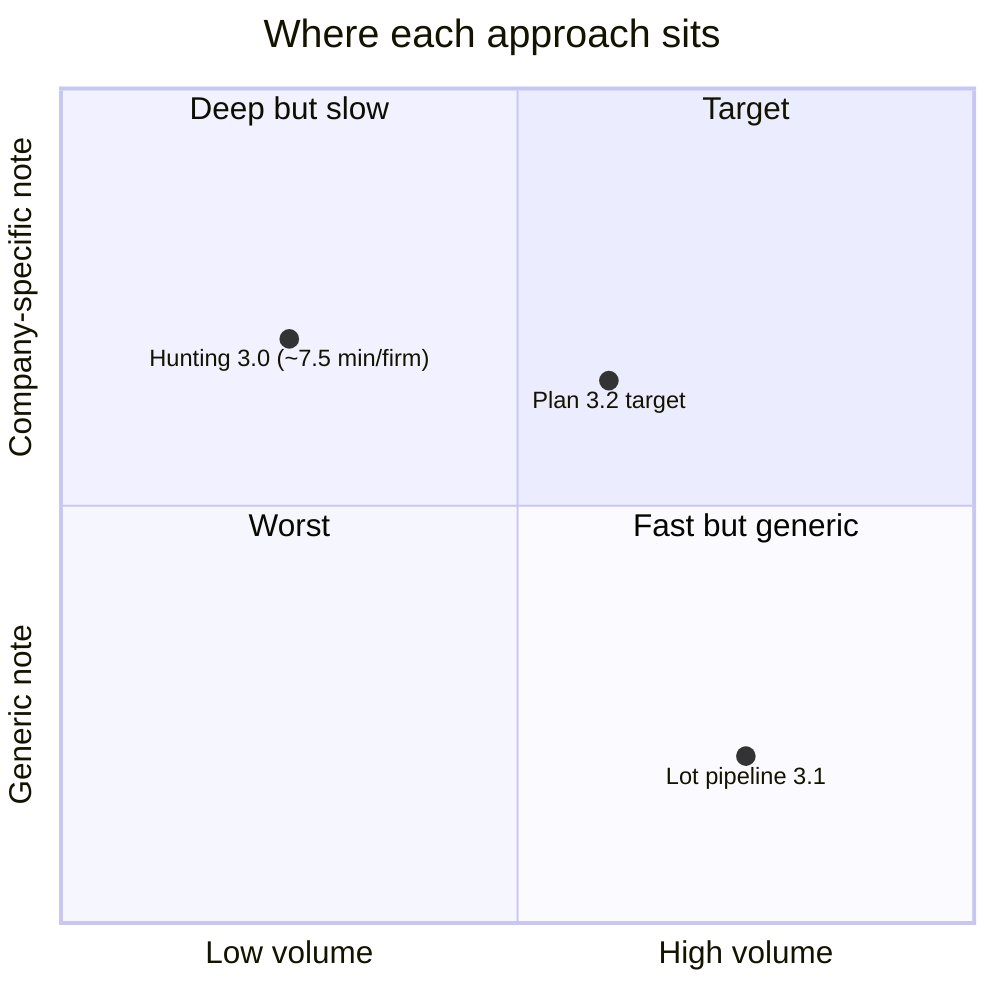

# 11. Known issues and open questions

Two kinds of items: **inconsistencies found in the files** while writing these docs (checkable facts), and **design questions** for whoever redesigns Voldi.

## 11.1 Inconsistencies in the repo (13.10.2026)

| # | Issue | Evidence |
|---|---|---|
| 1 | Two pipelines with contradictory rules. Hunting forbids any solution or product name in the note; the lot note must recommend catalog solutions (block 5). | `hunting/SKILL.md` "No solutions…", `product-blocklist.md` `@oriunde`; `lead31/note.py` `block5`, `lead31/verify.py` rule 7 |
| 2 | `CLAUDE.md` declares `voldi-3.0.md` the active plan and lists only `radar`, `hunting`, `pipedrive-note`; it never mentions `build_lot.py`, `scripts/lead31/`, `industries/` or `lots/`. It also says "Radar and hunting read no catalog file", true, but the lot pipeline does. | `CLAUDE.md` |
| 3 | `CLAUDE.md` says the dossier is "implemented in 3.1"; 3.1 implemented the lot pipeline instead. Dossier does not exist. | `CLAUDE.md`, `voldi-3.1.md` |
| 4 | Plan 3.0 Status says `write_mode: off` and addNote/updateLead on `ask`; current files say `write_mode: on` and both in `allow`. The switch is not recorded. | `config/hunting-mode.md`, `.claude/settings.json`, `voldi-3.0.md` Status |
| 5 | Plan 3.2 Status says "no code file changed", but `lead31/*.py` and `tests/test_lead31.py` were modified after `voldi-3.2.md` and already contain Phase 1 fixes (separate `jobs_source`, search-log site states, `is_legal_entity`, group blocking, `detect_group`, `shared_numbers`, `uniquify_questions` removed). | file modification times; code |
| 6 | `signals.json` still has 27 entries with legacy status `negăsit` and no `search_log`. The current verifier fails every legacy `negăsit`, so rebuilding the lot now would most likely fail those notes. I did not run it: **I cannot confirm.** | `signals.json` counts; `lead31/verify.py` `_site_problems` |
| 7 | The Excel on disk (`distributie-angro_2026-10-12.xlsx`) was produced by an earlier version of the code. | 3.1 handoff + file dates |
| 8 | `README.md` refers to "SKILL.md §2.9" (old company-research numbering) and describes the system as "read leads with label research … write a note", which matches neither current pipeline exactly. | `README.md` |
| 9 | Hunting skill still says addNote/updateLead are on `ask` "until Radu moves them to allow". | `hunting/SKILL.md` "Approval" |
| 10 | Two verifiers, two note formats, no shared schema for "a researched company"; the lot side and the Pipedrive side share no code path. | §2.4 |
| 11 | `pipedrive_read.py` / `pipedrive_write.py` / `fetch_listafirme_page.py` are unused by any skill (skills use the MCP connector and Claude in Chrome). | skills vs. scripts |
| 12 | `catalog/standard-solutions.md` is empty; 105 of 106 cards are `?-E`; S58–S106 have no verified public page. | catalog |
| 13 | The `researched - high` label id is the old "Cercetat" label, so leads tagged before 06.10.2026 look HIGH without having been through hunting. | field map |
| 14 | Lead-in whitelist in `lead31/verify.py` accepts "Aveți…" and "Cu <n>…", the template openings plan 3.2 wants to ban. | verify rule 8 |
| 15 | `test_lead31.py` depends on `../lead_bridge/src`; tests are not self-contained. | imports |

## 11.2 Quality findings from plan 3.2 (51 used notes)

| Finding | Number |
|---|---|
| Notes whose "where it loses money" came only from the subsector hypothesis | 40 / 51 |
| "Pe site: nimic găsit" | 22 / 51 |
| Job-ads block printing the reviews source (bug) | 49 / 51 |
| Useful reviews found | 0 |
| Job ads found in the whole lot | 3 |
| Questions analysed | 151, mostly from 4 templates ("inventariere" 24, "stocul în fiecare moment" 30, "zi obișnuită" 17, …) |

Root cause stated by Voldi itself: "no sentence in the note is written for that specific company". Claude produced short facts; Python templates produced everything else; tests checked presence, not quality.

## 11.3 Structural tensions

(Positions are qualitative, from the recorded trials and audit, not measured.)

1. **Volume vs. depth.** Target ≈ 100 calls/day; hunting measured ~7.5 min per company (≈ 12.5 hours for 100). The lot pipeline is fast but generic.
2. **Where the intelligence sits.** Claude-written notes (3.0) are specific but slow and depend on a 23 KB prompt being obeyed. Templates (3.1) are fast and testable but say nothing specific. 3.2 swings back to Claude writing every sentence.
3. **Signal scarcity.** For 5–49 employee firms, public triggers are rare (0 HIGH in both hunting trials; 0 reviews and 3 job ads across 70 wholesale firms). The design assumes signals that mostly do not exist for this segment.
4. **Fragile access.** One ListaFirme visit per firm, Radu's live Chrome, Cloudflare on eJobs, login walls on LinkedIn/Facebook, a Pipedrive connector without label filtering.
5. **No feedback loop.** Call outcomes are not read back (FEEDBACK block removed, "Notă apel" column filled by hand and never parsed), so the system cannot learn which hooks, industries or note styles book meetings.
6. **Rules spread across prose, regex and plans.** Every change goes through plan → audit → rewrite; behaviour depends on which files the model reads first.

## 11.4 Questions for a redesign

1. What is the unit of value: the note, the ranked call list, or the booked meeting? What metric decides if a change helped (meetings per 100 calls, minutes per firm, Radu's "aș suna" rate)?
2. Should research be tiered: a cheap pass on every firm (registry + "has own site?" + "any dated signal?") and deep research only where something exists?
3. One canonical company record (JSON schema keyed by CUI) that every stage reads and writes, with Pipedrive and Excel as views?
4. Solutions before the meeting or not? 3.0 says never, 3.1 says always. This choice drives the whole note design.
5. How should call outcomes flow back (structured call note, Pipedrive activity, label) and be used?
6. Which steps really need an LLM with a browser, and which could be APIs, cached data or plain code? Which sources are worth their cost per firm?
7. Should farming (existing client base, planned "later" since 3.0) share the same pipeline? 3.1 explicitly asks not to tie the lot source to LeadBridge for this reason.
8. Constraints to keep regardless: no bypassing logins/paywalls, add-only CRM writes, explicit approval for changes, Romanian output, facts with link + date, nothing run on the Vodafone laptop, LeadBridge / ListaFirme extraction / Pipedrive import untouched by Voldi.
