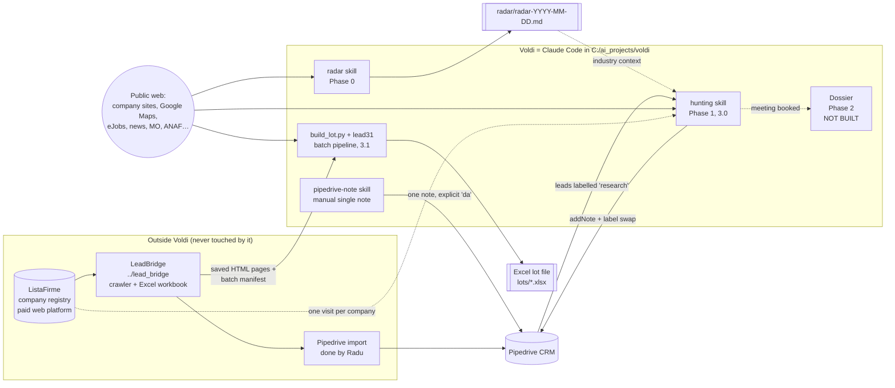

# Voldi documentation

Voldi is a pre-call research assistant for one B2B salesperson (Radu, Vodafone Business "hunter", Bucharest). It runs as **Claude Code inside the folder `C:\ai_projects\voldi`**, driven by markdown skills, with a small set of Python scripts for deterministic work (Pipedrive API, parsing saved ListaFirme pages, assembling and verifying notes, writing Excel).

This `docs/` folder describes the system **as it is on disk on 13.10.2026**. It was written from the repo files (skills, plans, config, scripts, tests, data). Where something could not be checked, it says so.

> Language convention in the repo: file names, skill names and instructions are English; everything Radu reads (notes, radar, Excel text) is Romanian. Romanian strings are quoted as they appear in the code, with a translation where it helps.

## Reading order

| # | File | What you get |
|---|---|---|
| 1 | [01-context-and-domain.md](01-context-and-domain.md) | Business context, who uses it, why it exists, glossary (CUI, CAEN, ListaFirme, `?-E`, PQP…) |
| 2 | [02-architecture.md](02-architecture.md) | Components, runtime model, external systems, folder map, the two pipelines side by side |
| 3 | [03-radar.md](03-radar.md) | Phase 0: industry radar skill |
| 4 | [04-hunting.md](04-hunting.md) | Phase 1: label-driven hunting skill, note format, priority logic, Pipedrive write sequence |
| 5 | [05-lot-pipeline.md](05-lot-pipeline.md) | The 3.1 script-first batch pipeline (`build_lot.py` + `scripts/lead31/`) down to the scoring algorithm |
| 6 | [06-data-model.md](06-data-model.md) | Every file format and schema: manifest, `signals.json`, lot `config.json`, industry sheet, catalog card, `Profile`, Pipedrive labels and fields |
| 7 | [07-verification-and-tests.md](07-verification-and-tests.md) | Both note verifiers rule by rule, the blocklist, test suites |
| 8 | [08-pipedrive.md](08-pipedrive.md) | Connector vs. REST scripts, permissions, labels, field map, `pipedrive-note` skill |
| 9 | [09-process-and-history.md](09-process-and-history.md) | How Voldi is built (architect / developer / DA), version history 17.09 → 13.10.2026 |
| 10 | [10-runbook.md](10-runbook.md) | Setup, commands, daily usage |
| 11 | [11-known-issues-and-open-questions.md](11-known-issues-and-open-questions.md) | Inconsistencies found while documenting, and questions for a redesign |

## One-page summary

- **Radar** answers "which industries have an external reason to be called now".
- **Hunting** answers "why call this company now and what to say", writes a Romanian call note into Pipedrive and relabels the lead.
- **Lot pipeline (3.1)** is a newer, parallel path: from a LeadBridge batch it builds an Excel file with one research note per company, mostly from templates.
- **Dossier** (meeting preparation) is specified but not implemented.

The most important fact for anyone redesigning: **3.0 (hunting) and 3.1 (lot pipeline) are two different pipelines with different note formats, different verifiers, different outputs and opposite rules about mentioning solutions.** See [11-known-issues-and-open-questions.md](11-known-issues-and-open-questions.md).

## Existing older docs

`docs/superpowers/` holds earlier specs and plans (17.09 and 24.09.2026) produced with a planning plugin. They describe the "Researcher skeleton" and the 2.x design and are history only.
